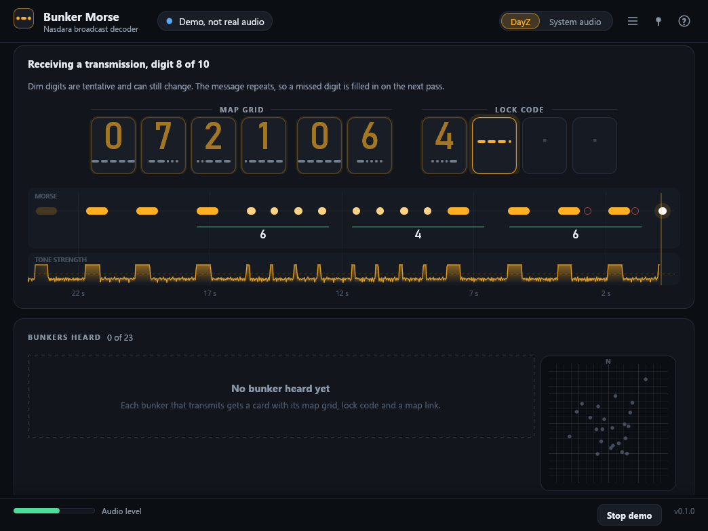
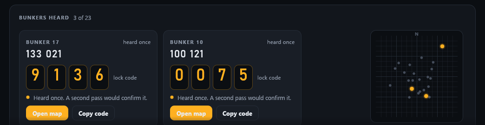

# Bunker Morse

A Windows app that reads the Nasdara bunker broadcast in DayZ for you. It listens to the game's audio, turns the Morse
beeps into digits, and shows each bunker's map grid and lock code on screen, with a button that opens the bunker on
[iZurvive](https://www.izurvive.com/nasdara/).

It was made so that deaf and hard-of-hearing players can use the bunker broadcast. It also helps anyone who finds Morse
by ear hard.



*Screenshots show the built-in demo, which plays synthetic beeps. No game audio is used or included in this repository.*

Unofficial fan project, not affiliated with Bohemia Interactive.

## Using it

1. Download `bunker-morse-<version>-windows-x64.exe` from the [latest release](../../releases/latest).
   Optionally check it against `SHA256SUMS.txt`.
2. Start DayZ, then start the app. A short walkthrough opens the first time.
3. In the game, hold a powered radio tuned to the bunker frequency during the broadcast window, 17:45 to 06:00 game time.
4. Watch the window. The ten digit slots fill in as the message arrives (six for the map grid, four for the lock code).
   Digits shown dimmed are tentative. When the message is complete a card appears for that bunker.

Three of the 23 bunkers transmit at a time, one after the other, about 90 seconds each, and the cycle repeats. Every
repeat fills in digits the previous one missed, so a card shows `?` for a digit until it has been heard clearly.



The window can stay above the game (pin button, needs the game in borderless windowed mode) and flashes its taskbar button
when a bunker has been read. Both are in the options menu next to the pin.

### If nothing is heard

The app listens to the audio of the DayZ process. On some PCs, mostly with virtual or spatial audio software, Windows
credits the game's sound to the audio engine instead, and the app hears silence. After 20 seconds of silence the window
offers **Listen to system audio**. That mode hears everything the PC plays, so it only accepts a message whose grid is
one of the real bunkers. Giving DayZ its own output device in the Windows volume mixer also fixes it.

### Windows warnings

The exe is not code signed, so SmartScreen may say it is an unknown app: choose More info, then Run anyway. The release
exe is built by GitHub Actions from the tagged source, and each release carries a build attestation you can check with
`gh attestation verify <file> --repo j-shelfwood/nasdara-bunker-morse`.

## Privacy and the game's anti-cheat

- Audio is analysed in memory and never stored or sent anywhere. The app makes no network connections. The only thing
  that leaves it is the iZurvive link, which opens in your browser when you press the button.
- Capture uses the Windows audio API for per-process loopback (the same API screen recorders use). The app does not read
  DayZ's memory, inject code or touch the game's files. It has not been reviewed by BattlEye or Bohemia, so use it at your own risk.
- `--log <file>` (optional, off by default) writes one line per decoded message with beep timings and digits, no audio.
  `--trace` adds the tone level per frame. They exist for bug reports.

## How it works

The beep is a tone near 985 Hz. The server plays each symbol on a fixed time grid, and the decoder scores every digit
against the tone level over time on that grid instead of counting beeps, so a beep lost to noise still leaves the digit
decidable. Lock codes are voted digit by digit over every repeat. The grid is matched to the 23 bunker positions.
Details, measurements and assumptions: [docs/how-it-works.md](docs/how-it-works.md).

## Limits

- Nasdara only. A server that changes the playback timings in its `cfgbunkerbroadcast.json` needs a matching `Timing`
  in `crates/decoder/src/grid.rs`.
- Tested on one PC over one live broadcast night plus generated audio. Loud wind or other noise under the beeps
  (about half as loud as a beep, in synthetic tests) makes digits unreadable.
- The in-game grid is assumed to be the same as iZurvive's. Three bunkers heard so far matched.

## Building

Needs a recent stable [Rust](https://rustup.rs). The decoder crate builds and tests anywhere; the app is Windows-first
(live capture needs Windows, the rest also builds on macOS and Linux).

```
cargo test --workspace
cargo run --release                      # the app
cargo run --release -- --log decode.log  # with the decoder log
cargo build --release                    # target/release/nasdara-bunker-morse.exe on Windows
```

The window can be rendered to PNG files without a display (used for the screenshots above):
`cargo run --release --example preview -- out-dir 60 300` plays the demo and saves the window at stream seconds 60 and 300.
Set `NASDARA_FONT_DIR` to a folder with `segoeui.ttf`, `segoeuib.ttf` and `bahnschrift.ttf` to see it with the Windows fonts.

## Contributing

Bug reports with a decoder log help most, especially from other audio setups and servers. Pull requests are welcome;
please run `cargo fmt` and `cargo clippy` first.

## License

[MIT](LICENSE).
